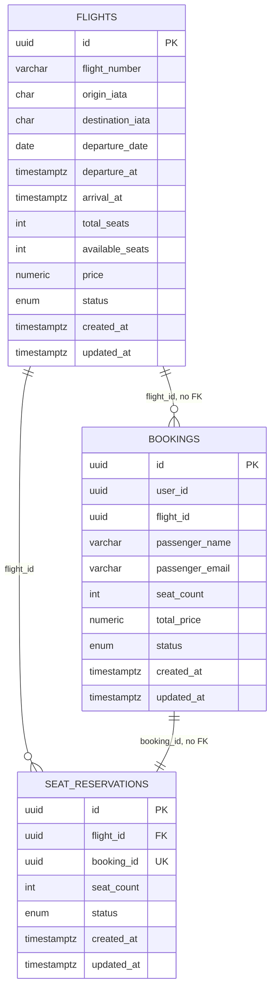

# Flight booking

Два сервиса: Booking принимает REST, Flight хранит рейсы и отдаёт gRPC. У каждого своя PostgreSQL.

Стек: Go, OpenAPI, gRPC, PostgreSQL, Redis, Flyway.

Вызовы Flight подписаны служебным JWT. Неудачный вызов повторяется до трёх раз, снаружи стоит circuit breaker. Выдача рейсов кешируется в Redis Sentinel: мастер, реплика и sentinel.

## Запуск

```bash
docker compose up --build
```

Booking слушает `http://localhost:8080`. Служебный health Flight — `http://localhost:8081/health`, gRPC — `localhost:9090`. Redis-мастер — `localhost:6379`, реплика — `localhost:6380`, Sentinel — `localhost:26379`.

Базы: `localhost:5432` (`booking` / `booking`) и `localhost:5433` (`flight` / `flight`).

`FLIGHT_JWT_SECRET` общий для обоих сервисов. Пустой секрет не даёт процессу стартануть. `CACHE_TTL` задаёт время жизни ключей кеша, по умолчанию 5 минут, допустимый диапазон — от 5 до 10 минут. В логе Flight у чтения кеша есть `result=hit` или `result=miss` и сам ключ.

Повтор идет только при `UNAVAILABLE` и `DEADLINE_EXCEEDED`: паузы перед второй и третьей попыткой — 100ms и 200ms. `CB_FAILURE_THRESHOLD` по умолчанию 5, `CB_OPEN_TIMEOUT` — 15s. В логе Booking переход пишется как `CLOSED → OPEN`. Пока breaker открыт, клиент получает 503 `SERVICE_UNAVAILABLE`.

Проверка:

```bash
curl -sS http://localhost:8080/health
curl -sS 'http://localhost:8080/flights?origin=VKO&destination=LED&date=2026-04-01'
```

Остановка с удалением данных:

```bash
docker compose down -v
```

E2E ходит в уже поднятый compose и меняет остатки мест. Перед повторным прогоном нужен чистый volume:

```bash
docker compose down -v && docker compose up --build -d
python3 scripts/e2e.py
```

Кодогенерация (её же выполняет сборка образа):

```bash
make generate
```

`internal/flightv1/*.pb.go` и `internal/booking/api/openapi.gen.go` лежат в `.gitignore`.

## Схема данных

У рейса уникальна пара `(flight_number, departure_date)`. `flight_id` и `booking_id` связывают сервисы без внешнего ключа. Тот же текст лежит в [docs/er.mmd](docs/er.mmd).



## Контракт

REST: `api/openapi/openapi.yaml`. gRPC: `api/proto/flight/v1/flight.proto`.

`user_id` клиент передаёт сам. Сервис не заводит пользователей и не проверяет владельца при чтении и отмене бронирования.

`UpdateFlight` есть только в gRPC. Метод меняет цену, статус и время вылета в пределах той же календарной даты. Номер рейса, маршрут и число мест он не меняет.

Повторный `ReserveSeats` с тем же `booking_id`, рейсом и числом мест возвращает активную резервацию и не списывает места ещё раз.

Демо-рейсы вставляет миграция Flight. `SU1001` (`00000000-0000-4000-8000-000000000001`) — пять мест VKO→LED на 2026-04-01.
